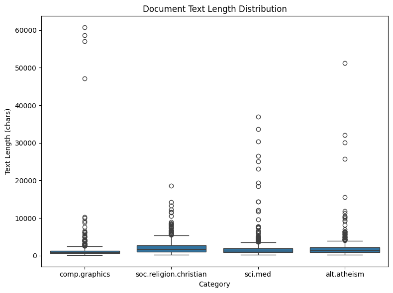
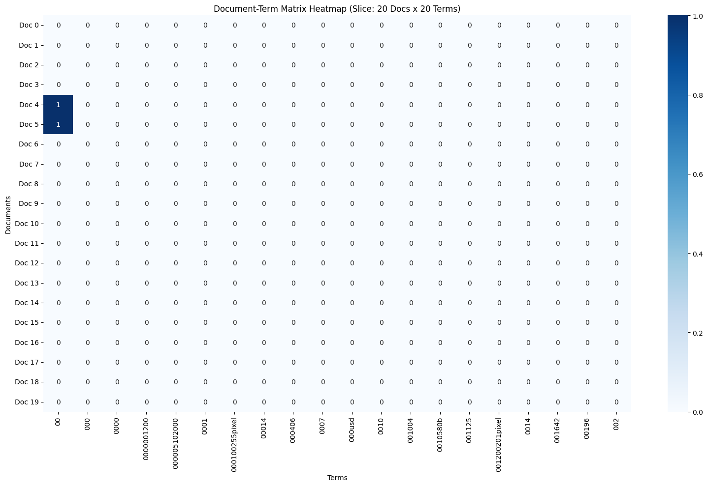
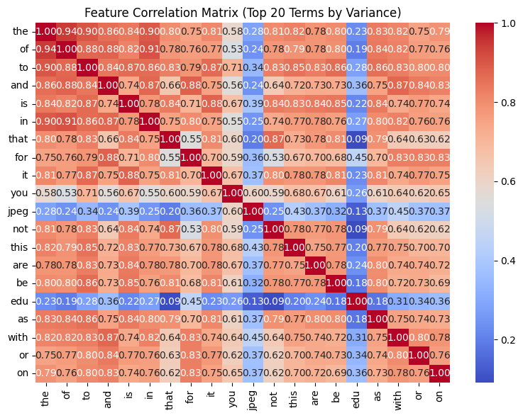
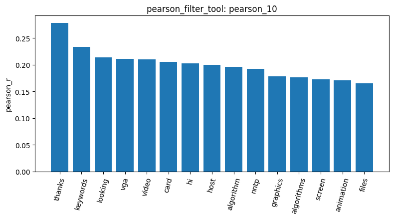
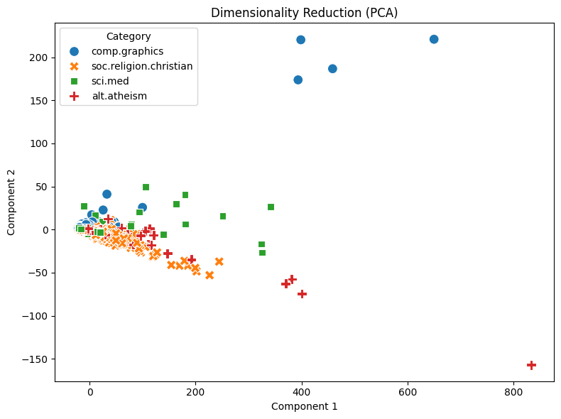

The analysis began by loading the dataset and examining document characteristics. As shown in the box plot , most articles are relatively short with a few outliers. The initial document-term matrix was highly sparse . To reduce noise, I applied a variance filter with a 0.01 threshold, removing roughly 30,000 insignificant terms. The correlation among the top 20 remaining features is visualized in the correlation matrix . Additionally, visualizing the Pearson correlation results (result_id: pearson_10) highlighted top category-specific terms like "thanks," "keywords," and "vga" .

The pattern mining phase required significant debugging. Running mine_patterns_tool on the comp.graphics category initially crashed due to an encoding bug with non-ASCII characters (e.g., 'é'), which I resolved by updating the tool's sanitization logic. Subsequently, setting min_sup=5 with tfidf filtering caused a combinatorial explosion that exhausted system memory. After restarting the kernel, I switched to the term_frequency filter with a safer threshold of min_sup=9, successfully extracting 4,652 frequent patterns.

Due to the kernel restart, I re-ran build_dtm_tool to reconstruct the global feature matrix. Finally, I applied PCA dimensionality reduction to visualize the document clusters. The resulting scatter plot  successfully compresses the high-dimensional feature space into two dimensions, clearly displaying the spatial distribution and separation of the different text categories.