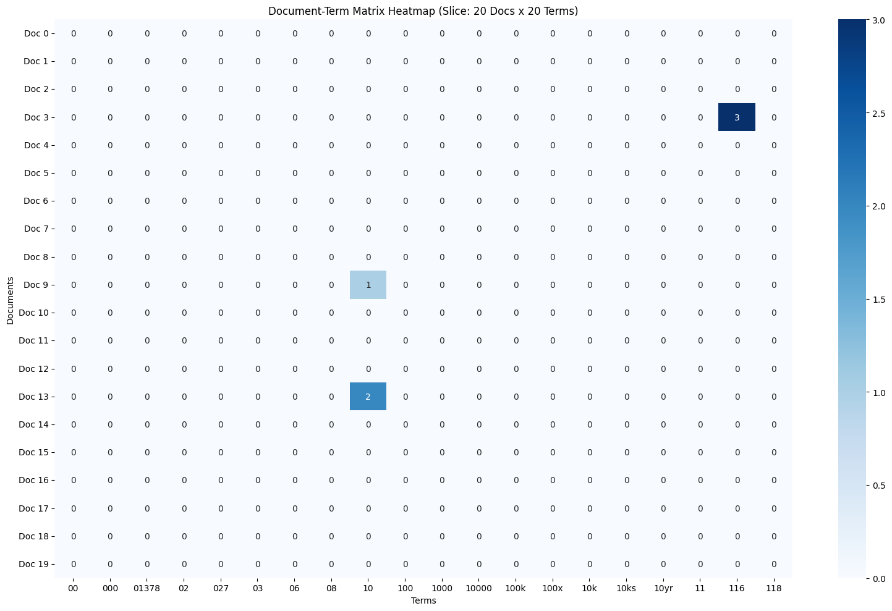
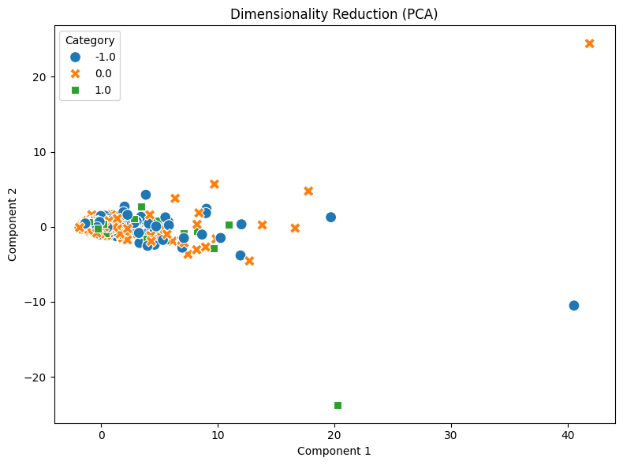
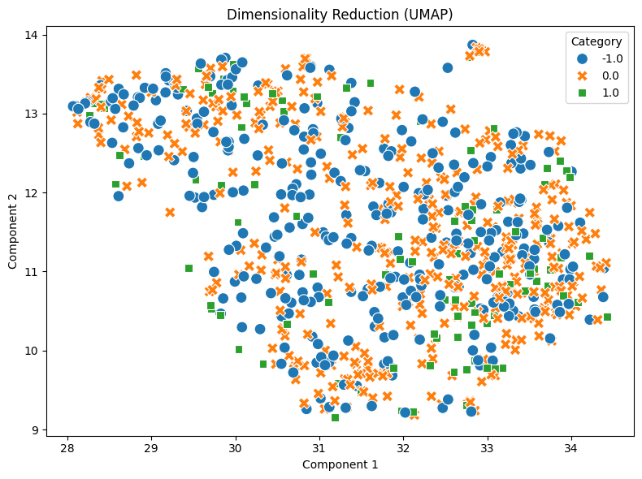
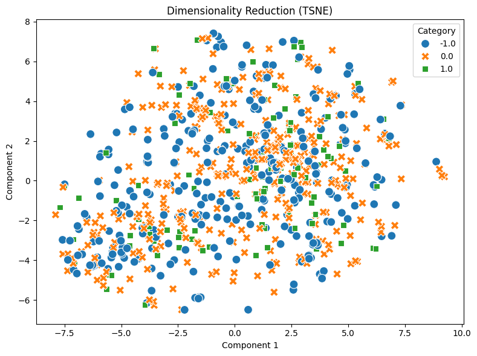

The execution of the pipeline proceeded smoothly. The analysis began by loading the Reddit stock sentiment dataset, which initially contained 847 entries. Most of the data consisted of brief, single-line sentences (e.g., "He didn’t say thank you."). After identifying and dropping 23 duplicate entries, the dataset was reduced to 813 clean documents for further processing.

Next, I generated the document-term matrix (result_id: dtm_7), yielding 4,313 unique terms, and visualized its high sparsity using a heatmap  . To filter out noise, I applied the variance filter tool with a 0.01 threshold, which effectively removed 3,823 low-variance terms, leaving 490 core features. For pattern mining, I focused on the positive sentiment category (1.0) using the variance filtering method. Initially, setting min_sup=10 yielded no results due to the small size of the positive dataset. After adjusting the threshold to min_sup=3 (result_id: patterns_14), I successfully extracted 60 frequent patterns, including meaningful co-occurrences like ['better', 'economy'] and ['want', 'economy'].

Finally, I applied three dimensionality reduction techniques to the feature space: PCA  , UMAP , and t-SNE . Due to the short and scattered nature of the text, the resulting scatter plots showed heavy overlap among the sentiment categories, making it difficult to distinguish clear clusters. To conclude, I evaluated textual similarity using the cosine similarity tool. Comparing two random short comments (doc_index 0 and 1) predictably resulted in a Cosine Similarity Score of 0.0 (result_id: similarity_19) due to matrix sparsity. However, targeting two longer comments with positive sentiment (doc_index 3 and 17) yielded a meaningful Cosine Similarity Score of approximately 0.218 (result_id: similarity_20), successfully demonstrating partial feature overlap in the vector space.